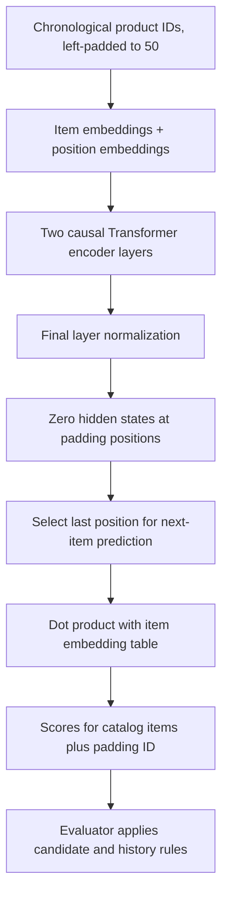

# SASRec Model 0 architecture

This folder contains the recommendation models. [sasrec.py](sasrec.py) defines
the team's ID-based Model 0: it reads a user's products in chronological order
and scores the possible next products. It is a configurable adaptation of the
team's Notebook 08 TinySASRec, not an independently validated reproduction of
the original paper's exact architecture or reported scores.

SASRec means **Self-Attentive Sequential Recommendation**. This Model 0 uses
product IDs and their order; it does not read product descriptions or call an LLM.

## Architecture and data flow



| Component | What it does | Where to look |
|---|---|---|
| Item embeddings | Maps each product ID to a learned vector. ID 0 is reserved for padding. | `item_embedding` in `__init__()` |
| Position embeddings | Adds a learned vector for the position in the input sequence. | `position_embedding` and `hidden()` |
| Causal self-attention | Allows each real position to attend to itself and earlier real products, never future positions. | Attention mask in `hidden()` |
| Transformer blocks | Combine attention with a feed-forward network, residual connections, layer normalization and dropout. | `nn.TransformerEncoderLayer` and `self.encoder` |
| Final normalization | Normalizes the resulting hidden vectors; padded hidden states are then set to zero. | `self.norm` and `masked_fill()` |
| Catalog scoring | Reuses the item embedding table as output weights. There is no separate prediction-layer bias. | `forward()` / `next_item_scores()` |

Each Transformer block uses a feed-forward width of `4 * hidden_size` and GELU
activation. The code uses PyTorch's default post-normalization encoder layer
(`norm_first=False`), followed by the model's additional final LayerNorm.
Dropout operates inside the Transformer layers; there is no separate explicit
embedding-dropout layer in this class.

For input item `x_t` at position `t`, the starting vector is:

```text
z_t = item_embedding[x_t] + position_embedding[t]
score(item j) = dot(final_hidden_state, item_embedding[j])
```

The scores are logits, not probabilities. Ranking uses their relative order.

## Inputs, outputs and training objective

Let `B` be batch size, `L` sequence length, `H` hidden size, `N` the number of
real catalog items and `K` the number of nonzero target positions.

| Method / tensor | Shape | Purpose |
|---|---|---|
| `tokens` | `[B, L]` | Integer item IDs in `0..N`; `L <= max_len`. |
| `hidden(tokens)` | `[B, L, H]` | Contextual representations for each position. |
| `forward(tokens)` | `[B, L, N+1]` | Scores at every sequence position, including the padding column. |
| `next_item_scores(tokens)` | `[B, N+1]` | Scores from the last sequence position. |
| `training_logits(tokens, targets)` | `[K, N+1]`, `[K]` | Scores and labels only where the target is nonzero. |

The [sequence loader](../data/sequence_dataset.py) builds shifted next-item
training pairs. For example, products `[12, 37, 9, 24]` yield inputs
`[12, 37, 9]` and targets `[37, 9, 24]`, left-padded to the configured length.
The [trainer](../training/trainer.py) applies cross-entropy to these nonpadding
targets. `training_logits()` avoids building catalog scores for padded targets.

Evaluation uses the last hidden state to predict the held-out next item. The
model class itself does not filter previously seen products or compute NDCG.
Those responsibilities belong to the shared evaluator and its adapter. See
the [evaluation README](../evaluation/README.md).

## Padding and initialization

- Item and position embeddings start from a normal distribution with mean 0
  and standard deviation 0.02. The item-padding row is explicitly zeroed at
  initialization.
- Real queries cannot attend to padded keys or future tokens. Padded queries
  may attend to themselves to avoid an entirely masked attention row.
- Hidden states at padded positions are explicitly zeroed after the encoder.
- Position IDs refer to absolute slots in the padded sequence. Changing the
  amount of left padding also changes position embeddings. The padding-isolation
  test therefore zeroes the position table on a test copy before comparing
  padded and unpadded inputs.

## Experiment settings

The experiment configuration, rather than constructor defaults, determines the
training setup. See [config.json](../../configs/config.json).

| Setting | Agreed search / training setup |
|---|---|
| Maximum sequence length | 50 |
| Hidden size | Search 64 or 128; selected 128 |
| Transformer layers | 2 |
| Attention heads | 1; the class constructor defaults to 4, so pass the configured value explicitly |
| Dropout | Search 0.2 or 0.5; selected 0.5 |
| Learning rate | Search 0.001 or 0.0005; selected 0.0005 |
| Optimizer / weight decay | Adam / 0 |
| Batch size | 128 |
| Epoch limit / early-stopping patience | 200 / 10 |
| Learning-rate scheduler | None |
| Selection | Full-catalog validation NDCG@10, seed 42 |
| Winner repeats | Seeds 43 and 44 |

See the [recorded full-grid results](../../docs/project_notes/model0_full_grid_20261107/README.md).
The best epoch is the epoch of the selected checkpoint, not necessarily the last
epoch executed. Test data is not used to select hyperparameters.

## Usage

Run from the repository root in the project's configured Python environment.
The example creates an untrained model and checks its output shape.

```python
import torch
from src.models.sasrec import SASRec

model = SASRec(
    n_items=100, max_len=50, hidden_size=128,
    num_heads=1, num_layers=2, dropout=0.5,
).eval()
tokens = torch.zeros((1, 50), dtype=torch.long)
tokens[0, -3:] = torch.tensor([12, 37, 9])
with torch.no_grad():
    scores = model.next_item_scores(tokens)
assert scores.shape == (1, 101)  # 100 real products plus padding ID 0
assert torch.isfinite(scores).all()
```

For a trained model, use [load_selected_model()](../training/checkpoints.py),
which verifies the saved selection and configuration before loading the weights.
See the [training README](../training/README.md) for the experiment workflow.

## Tests

```bash
python -m unittest discover -s tests -p 'test_sasrec*.py' -v
```

- [test_sasrec.py](../../tests/test_sasrec.py): finite outputs/gradients with
  padding, and changing future tokens does not change an earlier representation.
- [test_sasrec_padding.py](../../tests/test_sasrec_padding.py): isolated padding
  behavior, zero padded hidden states, finite all-padding scores, and agreement
  between full-forward and optimized scoring paths.
- [test_sasrec_init.py](../../tests/test_sasrec_init.py): initial loss near chance
  on a synthetic fixture and a zero padding embedding at initialization.

These tests check implementation behavior. They do not prove that the original
paper's published results have been reproduced. The original model reference is
[Kang and McAuley, Self-Attentive Sequential Recommendation (2018)](https://doi.org/10.1109/ICDM.2018.00035).
